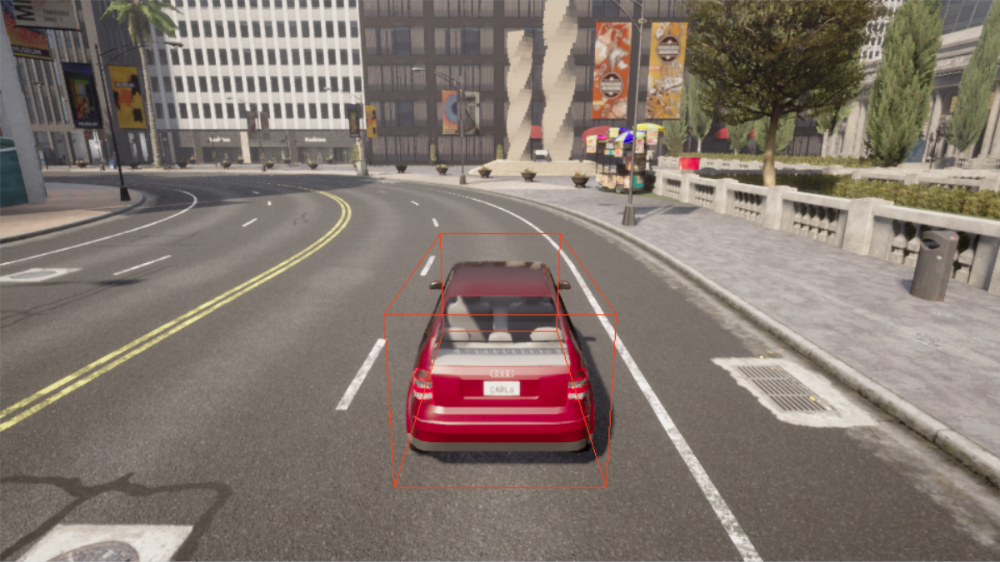

# 项目工作流-机器人篇



对于机器人开发的项目，随着开发周期的变长，带来的一个问题是，一些控制代码、测试数据、环境配置、通信日志和训练数据集会在工作空间中严重耦合，导致项目的占用资源越来越大，不易于agent进行阅读和维护。因此，参考最近科研工作流的整理思路，我决定整理一下机器人项目的工作流，一方面方便开发者维护，另一方面，也为AI4S提供一个可以实践的基座，让coding agent可以harness这样的开发任务。

## 痛点分析

总结来讲，现在无论是开源项目，还是闭源产品，在机器人仿真开发上面的能力，都没有超过通用coding agent的能力。众多仿真的库非常庞大，而且运行起来之后，仿真环境会有很多的状态（机器人位姿，传感器数据，环境参数等），并产生非常多的数据（仿真数据、日志数据、训练数据等）。痛点可以概括如下：

1. 上下文爆炸：ROSBag、PX4 ULog、几千行日志和全部传感器数据在模糊的意图下会被一股脑塞进上下文，导致agent注意力分散，任务长跑能力降低。
2. 物理规律模糊：对于3D物理世界，LLM的理解没有VLM视觉模型，也没有WM的理解更到位，物理规律上的约束可能在语义上仅仅只是一句强相关的上下文，由此设计出来的代码运行逻辑报错，会导致模型浪费大量token围绕一个显而易见的问题兜圈子。

以上是两个机器人项目较为突出的问题，而作为工程本身，其还有一些通用的问题，比如：Agent 执行发散，吐出的报告难以理解，文本内容膨胀严重等等。

## 解决思路

对于通用的项目经验，相关工作较多，主要集中在coding debug和closing issue上，几个较为常见的bench也是围绕其整理的。我参考了几篇文献的工作，还有一些开源仓库贡献，做出总结如下：

1. 限制工作阶段，不同阶段结束之后进行交付，审阅，之后再合入主分支
2. 限制工作分工，不同角色分开同时还需要保证长程任务对话不爆炸，采取低熵通信设计
3. 限制接入工具，即使模型由于上下文模糊想要越权也无法实现

对于机器人项目，相关论文和工作较为有限，但是还是有一些参考的。也同样总结经验如下：

1. 限制证据入口：不要把完整 ROSBag、PX4 ULog、几千行日志和全部视频直接塞进上下文，而要先做事件检测、时间切片和结构化摘要。
2. 限制实验变量：每次实验只改变一个变量，保留基线版本，做 A/B 对比，禁止同时改代码、参数、世界文件和控制器后再判断原因。
3. 限制验收权限：编译通过、测试通过、数值指标通过、视觉语义通过、真人确认，是五种不同的验收，不能相互替代。
4. 限制物理动作权限：代码执行权限、仿真控制权限、真机控制权限必须分开；急停、限速、地理围栏和硬件保护不能依赖 LLM 自觉遵守。

在这些工程经验之外，还有一些整合了 ROS、PX4 等资源的 Agent：

### ROSA：目前较直接的 ROS 系统 Agent

NASA-JPL ROSA 支持 ROS 1 和 ROS 2，把节点、话题、服务、参数、日志等操作封装成工具，可以通过自然语言检查和控制 ROS 系统。其不是完整的仓库coding agent，但是可以作为一个skill或者mcp，在整个系统里充当 ROS 运行时观察与诊断层，避免agent直接接触到ROS的复杂上下文。

仓库地址：https://github.com/nasa-jpl/rosa

###  Bagel：目前较完善的 ROS／PX4 日志分析入口

Bagel 可以通过 MCP 接入 Claude Code、Codex、Cursor 等 Agent，支持 ROSBag、MCAP、PX4 ULog 等数据。它有一个很好的工程设计：消息数据上的计算由 DuckDB SQL 完成，并展示查询供人审计，提供了进一步的封装。

其功能涵盖：PX4 飞后日志和 ROSBag 初步分诊；电池、电压、IMU、GPS、数据中断检查；多话题时间对齐和相关性分析；找到异常区间后，截取前后窗口交给 Agent；将人工验证过的分析步骤保存成可复用能力。

仓库地址：https://github.com/extelligence-ai/bagel

### RHO／OpenRUA：代表更前沿的 Coding Agent 路线

RHO(Robotics Harness Optimization) 是一个基于工具增强的coding agent的设计范式。该范式可以编写临时测试、运行机器人环境、读取 traceback、查询视觉差异工具并修改多文件仓库，同时隔离 Agent、机器人环境和评估器，降低作弊和 Reward Hacking。

OpenRUA 则是走了项目的设计思路，构建了一个基于terminal的cli，让 Coding Agent 直接通过 ROS 2 和机器人环境完成操作任务的路线。

Robotics Harness Optimization 论文地址：https://arxiv.org/abs/2606.16458

OpenRUA 项目地址：https://github.com/terminalworld/OpenRUA

### 视觉验收：审查语义覆盖不到的一些内容

上述的agent项目，可以涵盖数据量较大，上下文膨胀的问题，具有初步解决方案的能力。但是对于一些物理规律的约束（比如碰撞检测和轨迹规划），尚不能完全覆盖，这个问题可以采用两条路线设计：

1. 对于运动学，轨迹平滑等问题，提供给agent成熟的控制动力学和运动学方程，以便agent在设计控制器时，能够直接调用这些方程，保证设计准确度的同时降低token消耗。
2. 对于碰撞检测、目标追踪等问题，尝试采用VLM多模态的大模型，具有原生的多模态能力，其先验知识可以较好地覆盖物理规律的约束，未来可以考虑集成WM的设计思路。

其中比较适合视觉判断的内容：

- 机器人是否明显翻倒、穿透、飞出场景；
- 机械臂是否接近或抓取目标物体；
- 目标物体是否出现在预期区域；
- 场景是否加载错误、模型是否缺失；
- 摄像头是否被遮挡、画面是否全黑；
- RViz／Gazebo 中是否存在明显的视觉异常；
- 修复前后图像或视频是否出现明显变化。

相反，不应该只依靠视觉判断的内容

- 位置误差是否小于 2 cm；
- 控制器是否稳定、是否存在高频振荡；
- TF 时间戳和外推错误；
- 接触力、力矩、电机饱和；
- 瞬时碰撞或单帧异常；
- 深度、尺度、遮挡后的精确空间关系；
- 多次运行是否具有一致成功率。

RoboVQA 的研究显示，视频条件相较单张图像能明显改善机器人任务理解，同时零样本模型在真实机器人场景中的表现仍有明显不足。因此，**不要只给最终截图，至少给关键时刻的多帧序列。**

AutoEval 的实践也很有参考价值：它不是直接信任通用 VLM，而是针对具体场景收集约 1000 张成功、失败和无效状态图像，微调分类器，并用误判样本继续训练，达到较高验证准确率后才投入自动评估。这说明可靠视觉验收通常需要**任务内校准和领域数据**，而非一句“请看图判断是否成功”。

所以，较为推荐的视觉验收输入包

每次仿真不要只返回视频，而是生成一个同步的 Evidence Bundle：

```text
任务规格与验收条件
├─ 开始、异常前、异常时、恢复后、结束等关键帧
├─ 固定多视角图像，必要时附带短视频
├─ 相机内外参、视角说明、仿真时间戳
├─ 同时刻位姿、速度、控制量、接触和碰撞数据
├─ 关键指标曲线及数值验收结果
└─ 与基线版本的视觉差异和指标差异
```

视觉 Agent 的输出建议强制为：

```text
verdict：PASS／FAIL／UNCERTAIN
观察依据：哪些帧、哪个区域、看到了什么
覆盖的验收项：只能覆盖哪些语义条件
无法判断的项目：遮挡、视角、精度或信息不足
建议补充的证据：另一个视角、更多帧或某项数值数据
```

如果有必要，最终可以采用三级裁决：

```text
确定性数值 Oracle：主要负责 PASS／FAIL
→ VLM：补充语义和视觉异常判断
→ 人工：处理不确定项、安全项和最终交付
```

## 哪些行为需要禁止

这些是较为典型的LLM无意识行为，应当予以禁止：

1. 看到一个 Python traceback 就立即修改多层代码；
2. 同时修改控制参数、URDF、世界文件和节点源码；
3. 删除报错日志、降低告警等级或绕过 PX4 failsafe；
4. 通过放宽测试阈值让任务“成功”；
5. 在单次仿真成功后宣布修复；
6. 把原环境已有的失败全部算成本次任务，不断扩修。

## 参考文献

[1] XIA C S, DENG Y, DUNN S, et al. Agentless: Demystifying LLM-based software engineering agents[EB/OL]. (2024)[2026-11-21]. https://arxiv.org/abs/2407.01489.
[2] BOUZENIA I, DEVANBU P T, PRADEL M. RepairAgent: An autonomous, LLM-based agent for program repair[EB/OL]. (2024)[2026-11-21]. https://arxiv.org/abs/2403.17134.
[3] RUAN H, ZHANG Y, ROYCHOUDHURY A. SpecRover: Code intent extraction via LLMs[EB/OL]. (2024)[2026-11-21]. https://arxiv.org/abs/2408.02232.
[4] ZHANG Y, RUAN H, FAN Z, et al. AutoCodeRover: Autonomous program improvement[EB/OL]. (2024)[2026-11-21]. https://arxiv.org/abs/2404.05427.
[5] HONG S, ZHUGE M, CHEN J, et al. MetaGPT: Meta programming for a multi-agent collaborative framework[EB/OL]. (2023)[2026-11-21]. https://arxiv.org/abs/2308.00352.
[6] ELMAAROUFI K, SVEGLIATO J, KALADE S, et al. RHO: Your coding agent is secretly a roboticist[EB/OL]. (2026)[2026-11-21]. https://arxiv.org/abs/2606.16458.
[7] SERMANET P, DING T, ZHAO J, et al. RoboVQA: Multimodal long-horizon reasoning for robotics[EB/OL]. (2023)[2026-11-21]. https://arxiv.org/abs/2311.00899.
[8] ZHOU Z, ATREYA P, TAN Y L, et al. AutoEval: Autonomous evaluation of generalist robot manipulation policies in the real world[EB/OL]. (2025)[2026-11-21]. https://arxiv.org/abs/2503.24278.
